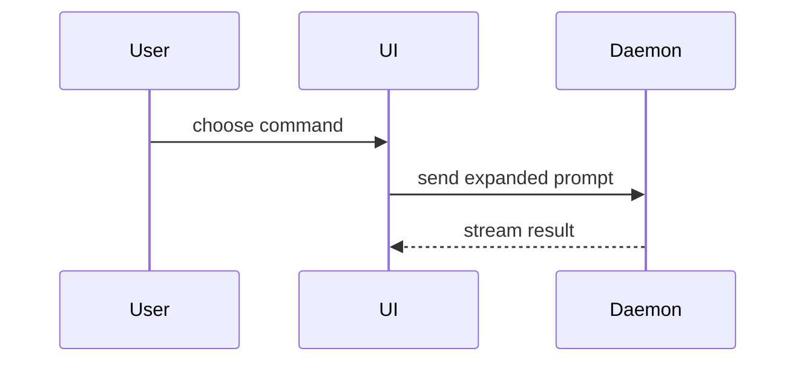

## Conventions

Read the `## Pull requests` section of `docs/agents/project.md` for this repo's branch naming, merge style, review rule and PR-body language. Where it is missing, use these defaults: branch `<issue#>-<slug>` cut from the latest `main`, one ticket per PR (an `/implement-spec` integration branch carries one spec), squash merge, body prose in English.

- The body starts with `Closes #<n>` for every ticket the PR resolves.
- The human merges once CI is green, after /code-review (and /qa for UI). Agents never run `gh pr merge`. A `contract` PR gets /code-review too, docs-only included.
- Before reporting a PR ready for merge, `git status -sb` shows the branch level with its remote: every commit is pushed and in the PR.
- A PR that changes a shared contract (the list in the `## Planning` section of `docs/agents/project.md`; without one, a schema, API or type other tickets build on, or a DB migration) contains only that change, gets the `contract` label, ends the body with a `cc` of the other owners `## Planning` names, and merges before any PR that uses it. If the change is hard to reverse, add an ADR in `docs/adr/`.

## After merge

The human merges, and GitHub deletes the remote branch. When told a PR is merged (or you see it merged), run `${CLAUDE_PLUGIN_ROOT}/tools/cleanup-merged.sh <branch>` unprompted and report what it removed. When the repo wired the opt-in SessionStart hook that `/setup-trussary-skills` offers, every new session also sweeps merged branches with `--merged` (log: `.git/cleanup-merged.log`), so a merge you miss is cleaned at the next session. Done when the worktree, local branch and a fast-forwarded local `main` are all reported.

Edit a PR body with `gh api -X PATCH repos/<owner>/<repo>/pulls/<n> -F body=@<file>` (the slug from `docs/agents/issue-tracker.md`; `gh pr edit` fails on old `gh`).

Use this template for writing the PR body (headings and labels stay English whatever language the prose is in):

```markdown
Closes #<n>

## Summary

<diagram, diff-sketch, or tree>

## Evidence

- **Before:** <output/failing test run, or for a UI ticket the QA Evidence artifact link>
  **After:** <output/passing test run, or for a UI ticket the QA Evidence link and its verdict>

## Merge Danger

**Door:** <one-way or two-way>

<optional: description>

**Blast Radius:** <one-word description>

<optional: potential ramifications of merge>

<only when the PR deletes or renames a test: `Removed tests:` then each removed test name with why>

## Run

<the Run record from docs/agents/models.md#run-record>
```

The `## Run` section is required when the PR changes the paths the `## Run record` section of `docs/agents/project.md` names (without one, every implementation PR), and its findings line is the count from a /code-review that ran on the branch. A PR that touches none of them leaves it out.

## Sections

Skip all preambles and keep prose brief. Write the prose in the language `## Pull requests` sets (default English). Use the user's domain language from `GLOSSARY.md`.

### Summary

Pick the smallest view that makes the key point clear.

- Show logic or an algorithm as pseudocode:

```text
on(save)
  if content is unchanged
    return cached result
  write new content
  return fresh result
```

- Show runtime control flow as a call tree:

```text
submitForm
  createSession
    persistPrompt
    launchAgent
  navigateToSession
```

- Show UI structure as a component tree, including state and module boundaries that matter:

```text
<SessionPage> (apps/example/src/routes/session.tsx)
  useSessionEvents()
  <SessionToolbar>
    <RunSkillButton> (packages/ui)
```

- Show file responsibility or a broad refactor as a shallow file tree:

```text
src/
├── commands/       # parses user actions
├── sessions/       # owns session state
└── transport/      # sends API requests
```

- Show component interaction, control flow, or data flow with Mermaid:



- Use `diff` when the point is what changes and the surrounding shape already exists. Match the diff shape to the topic.

For a component change:

```diff
 <SessionPage>
   useSessionEvents()
   <SessionToolbar>
+    <RunSkillButton />
   <SessionTimeline>
+    <SkillResultCard />
```

For a file-layout change:

```diff
 src/
 ├── commands/
+│   └── show-me.ts       # expands the slash command
 ├── sessions/
-└── transport.ts
+└── transport/
+    ├── client.ts
+    └── stream.ts
```

For a call-tree or call-stack change:

```diff
 submitForm
   createSession
     persistPrompt
+    expandSkillMention
     launchAgent
-  navigateToSession
+  navigateToSession
+    subscribeToEvents
```

For a state or control-flow change:

```diff
 on(save)
-  write content
+  if content is unchanged
+    return cached result
+  write new content
+  invalidate cache
```

- Show the whole block when most of it is new, when omitted context would hide ownership or order, or when the user needs a copyable target shape:

```ts
function expandSkill(command: string): string {
  const skillName = command.slice(1);
  return `use the ${skillName} skill`;
}
```

#### Guidance

Place each visual next to the short text it supports. Keep only the calls, files, props, states, and boundaries needed to answer the user's current question or the options to resolve the current discussion point.

You may use one of these, you may use several, it is unlikely you will use all of them. Use your judgement and don't overwhelm the user.

### Evidence

Concrete evidence that the change works. Show a before and after.

Screenshots are S-tier - when the environment is set up for it and the change is visual. They live in the QA Evidence artifact that `/qa` publishes, never in git: for a ticket with UI, Evidence is the artifact link plus a one-line verdict, with no images in the PR body.

Execution-based evidence is A-tier. Test results, console output. Show the exact test that now fails and passes, using pseudocode.

### Merge Danger

Describe whether it's a one-way or two-way door. You can walk back through two-way doors, but not one-way doors. A PR that is cheap to roll back is lower risk. Changes that involve destructive actions or hard-to-reverse decisions are one-way doors.

The blast radius is the potential impact or scope of the changes introduced by this PR. Consider all possibilities. Examples are layout shift, breakages for consumers, mobile responsiveness, etc.
